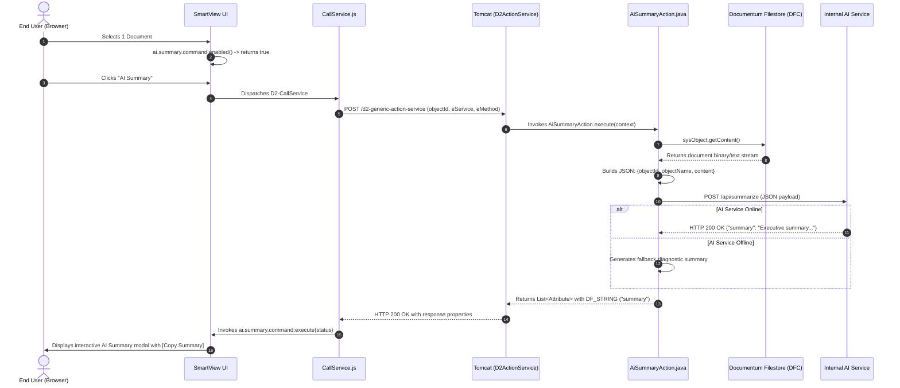

# Architecture, Flow & Implementation Guide: `AI Summary` in D2 SmartView

Welcome to the **D2 SmartView AI Summary Enhancement** project (**OpenText D2 SmartView SDK 25.4.1 / Runtime 25.4.0**).

This document serves as the **master blueprint and runtime guide**. If you are opening this workspace in a new session or handing this off to another engineer, **everything you need to understand, customize, configure, build, deploy, and troubleshoot** this project is detailed here.

> **SDK & Platform Baseline:**
> * **D2 SmartView SDK Version:** `25.4.1` ([`pom.xml`](pom.xml) `<d2.version>25.4.1</d2.version>`)
> * **SmartView Web Core:** `@dctm/dctm-web-core` `25.4.4` / `smartui-grunt-support` `7.1.1`
> * **Documentum Platform:** DFC `25.4.0`, D2FS `25.4.0`, Spring `6.1.13`, Jakarta EE
> * **Target Web Application:** OpenText D2-Smartview on Apache Tomcat (Linux / Windows)
> * **Java & Build Tooling:** OpenJDK 17, Node v20 LTS, Apache Maven 3.8+

---

## 📚 Table of Contents
1. [Executive Overview & What This Project Does](#1-executive-overview--what-this-project-does)
2. [End-to-End Architecture Primer](#2-end-to-end-architecture-primer)
3. [Complete File & Class Reference](#3-complete-file--class-reference)
4. [Deep-Dive: How Every Component Works](#4-deep-dive-how-every-component-works)
5. [Visual Architecture & End-to-End Sequence Diagram](#5-visual-architecture--end-to-end-sequence-diagram)
6. [How to Configure & Update the Internal AI Endpoint](#6-how-to-configure--update-the-internal-ai-endpoint)
7. [Local Testing with Mock AI Server](#7-local-testing-with-mock-ai-server)
8. [Build & Packaging Workflow](#8-build--packaging-workflow)
9. [Deployment Guide (Linux Tomcat & Windows)](#9-deployment-guide-linux-tomcat--windows)
10. [Troubleshooting & Solved Framework Quirks](#10-troubleshooting--solved-framework-quirks)

---

## 1. Executive Overview & What This Project Does

This project delivers an enterprise **AI Summary** feature inside OpenText Documentum D2 SmartView:

1. **Smart Context Menu Integration:** When a user selects **exactly one document** in any SmartView Doclist, Search Results, or Folder view, a new menu item **`AI Summary`** is dynamically displayed. It is strictly hidden or disabled when selecting folders, cabinets, repositories, or multiple items.
2. **Server-Side Content Extraction:** When clicked, SmartView triggers Documentum D2's `U4Generic` action framework. The backend Java service (`AiSummaryAction.java`) connects to the Documentum repository via DFC (`IDfSysObject`), extracts the document's **actual content stream** from the filestore, and reads its metadata (`r_object_id`, `object_name`).
3. **Internal AI POST Call:** The server sends an HTTP POST request carrying the document text and metadata to your enterprise internal AI Summary service (`/api/summarize`).
4. **Interactive Modal Presentation:** Upon receiving the AI response (`{"summary": "..."}`), SmartView launches a high-fidelity modal dialog (`DialogView` + Marionette + Handlebars) displaying the formatted executive summary with a 1-click **"Copy Summary"** button.
5. **Graceful Offline Fallback:** If the internal AI service is temporarily offline or unreachable, the action returns a detailed diagnostic summary showing document details, extracted text length, and clear instructions for endpoint connectivity instead of crashing.

---

## 2. End-to-End Architecture Primer

Documentum D2 SmartView is a **hybrid web application**:

```
┌────────────────────────────────────────────────────────────────────────────────────────┐
│                                   BROWSER (FRONTEND)                                   │
│  • Frameworks : Backbone.js, Marionette.js, Handlebars (hbs!), RequireJS, jQuery       │
│  • Components : CommandModel (ai.summary.command.js) & DialogView (ai.summary.dialog)  │
│  • Bootstrap  : d2svaisummary-init.js (sv.bootHold, sv.addExtension, sv.addBundleIndex) │
└───────────────────────────────────────────┬────────────────────────────────────────────┘
                                            │ HTTP POST /d2-generic-action-service
                                            ▼
┌────────────────────────────────────────────────────────────────────────────────────────┐
│                                   TOMCAT (BACKEND JAVA)                                │
│  • Frameworks : Spring WebMVC, D2FS (D2 Foundation Services), Documentum DFC           │
│  • Components : AiSummaryAction (IPluginAction), Java 17 HttpClient                    │
│  • Service    : D2ActionService -> executes execute(D2fsContext) via reflection        │
└───────────────────────────────────────────┬────────────────────────────────────────────┘
                                            │ HTTP POST (Internal Network / JSON)
                                            ▼
┌────────────────────────────────────────────────────────────────────────────────────────┐
│                               INTERNAL AI SUMMARY SERVICE                              │
│  • Endpoints  : REST API accepting JSON payload {objectId, objectName, content}        │
│  • Response   : JSON payload {summary: "..."}                                          │
└────────────────────────────────────────────────────────────────────────────────────────┘
```

### Why Server-Side Content Extraction instead of Browser-Side?
1. **Network Performance:** Documents can be large (10MB–50MB+). Fetching them down to the user's browser just to re-upload them to an AI service is slow and consumes client bandwidth.
2. **CORS Avoidance:** Internal enterprise AI services typically do not expose permissive CORS headers to client browsers.
3. **Security & Secrets:** API tokens, internal endpoints, and credentials remain secure inside the Tomcat server container.
4. **Native DFC Access:** D2FS runs directly inside Documentum's authenticated context with full session management (`context.getSession()`).

---

## 3. Complete File & Class Reference

All plugin code is located in **`plugins/D2SV-AI-Summary`**:

| # | File Path | Type | Role & Responsibility |
|---|---|---|---|
| 1 | [`pom.xml`](pom.xml) | Root POM | Multi-module parent declaring cross-platform dynamic `${maven.multiModuleProjectDirectory}/lib` and system `npm` execution. |
| 2 | [`plugins/D2SV-AI-Summary/pom.xml`](plugins/D2SV-AI-Summary/pom.xml) | Submodule POM | Configures Antrun Grunt compile, resource bundling, and packaging into `dist/D2SV-AI-Summary-1.0.0.jar`. |
| 3 | [`src/main/resources/xml/unitymenu/MenuContextDelta.xml`](plugins/D2SV-AI-Summary/src/main/resources/xml/unitymenu/MenuContextDelta.xml) | XML Delta | Injects `<menuitem id="ai_summary">` into `MenuContext`, enforces `<condition class="...IsDocument">`, and maps to `U4Generic`. |
| 4 | [`src/main/resources/strings/menu/MenuContext/MenuContext_en.properties`](plugins/D2SV-AI-Summary/src/main/resources/strings/menu/MenuContext/MenuContext_en.properties) | Properties | English label: `ai_summary = AI Summary`. |
| 5 | [`src/main/java/.../actions/AiSummaryAction.java`](plugins/D2SV-AI-Summary/src/main/java/com/opentext/d2/smartview/d2svaisummary/actions/AiSummaryAction.java) | Java | Extracts document stream via DFC, POSTs to AI endpoint, and returns typed attribute (`DF_STRING`). |
| 6 | [`src/main/java/.../D2SVAiSummaryPlugin.java`](plugins/D2SV-AI-Summary/src/main/java/com/opentext/d2/smartview/d2svaisummary/D2SVAiSummaryPlugin.java) | Java | Implements `ID2fsPlugin` for runtime discovery by D2FS plugin manager. |
| 7 | [`src/main/resources/smartview/SmartView.properties`](plugins/D2SV-AI-Summary/src/main/resources/smartview/SmartView.properties) | Properties | Binds Java plugin to UI namespace `d2svaisummary` and bundle `d2svaisummary-bundle`. |
| 8 | [`src/main/smartview/src/d2svaisummary-init.js`](plugins/D2SV-AI-Summary/src/main/smartview/src/d2svaisummary-init.js) | JS Init Hook | Raw IIFE script loaded by SmartView on page boot to hold startup, register extensions, and register bundle index. |
| 9 | [`src/main/smartview/src/d2svaisummary-extensions.json`](plugins/D2SV-AI-Summary/src/main/smartview/src/d2svaisummary-extensions.json) | JSON | Registers `d2svaisummary` in `d2/sdk/models/module.collection` and `d2/sdk/utils/commands`. |
| 10 | [`src/main/smartview/src/commands/ai.summary.command.js`](plugins/D2SV-AI-Summary/src/main/smartview/src/commands/ai.summary.command.js) | JS Command | Enforces client-side document selection (`enabled`), receives summary payload, and launches `DialogView`. |
| 11 | [`src/main/smartview/src/dialogs/ai.summary.dialog.view.js`](plugins/D2SV-AI-Summary/src/main/smartview/src/dialogs/ai.summary.dialog.view.js) | Marionette View | Controller for modal dialog body, mapping template variables. |
| 12 | [`src/main/smartview/src/dialogs/impl/ai.summary.dialog.hbs`](plugins/D2SV-AI-Summary/src/main/smartview/src/dialogs/impl/ai.summary.dialog.hbs) | Handlebars | HTML structure of the summary modal (document header badge, scrollable summary box). |

---

## 4. Deep-Dive: How Every Component Works

### A. The Menu Definition & Document-Only Condition (`MenuContextDelta.xml`)
```xml
<?xml version="1.0" encoding="UTF-8"?>
<delta>
  <insert position-after="menuContextCopyLink">
    <menuitem id="ai_summary">
      <dynamic-action class="com.emc.d2fs.dctm.ui.dynamicactions.actions.U4Generic"
                      eService="com.opentext.d2.smartview.d2svaisummary.actions.AiSummaryAction"
                      eMethod="execute"
                      eMode="SINGLE"
                      rAction="d2svaisummary/commands/ai.summary.command:execute"
                      rType="JS"/>
      <condition class="com.emc.d2fs.dctm.ui.conditions.typeparts.IsDocument" equals="true" showifinvalid="false"/>
    </menuitem>
  </insert>
</delta>
```
* **`<condition class="...IsDocument" equals="true" showifinvalid="false"/>`**: Crucial D2FS condition. Without this condition, D2 attaches the menu delta to every single repository object (including folders and cabinets). With this condition, D2FS filters out anything that is not a document.
* `eService` & `eMethod`: Fully qualified class and method invoked on the Tomcat backend.
* `rType="JS"` & `rAction="...:execute"`: SmartView RequireJS module and callback function executed in the browser after the backend action finishes.

---

### B. The SmartView Bootstrap Lifecycle (`d2svaisummary-init.js`)
SmartView loads all plugin `*-init.js` files as raw `<script>` tags **before RequireJS (`define`) is placed in the global scope**.
```javascript
(function () {
  'use strict';
  console.log('[D2SV-AI-Summary] >>> d2svaisummary-init.js EXECUTING <<<');

  if (typeof sv === 'undefined') {
    return;
  }

  const { bootHold, addBundleIndex, addExtension, config } = sv;
  const promise = bootHold(); // Hold SmartView startup until extensions register

  addExtension('d2svaisummary/d2svaisummary-extensions.json');
  addBundleIndex(`${config.otherBundlesLocation}/d2svaisummary/bundles/d2svaisummary-index.js`);

  promise.resolve(); // Release startup
})();
```
* Calling `sv.addExtension('d2svaisummary/d2svaisummary-extensions.json')` registers `d2svaisummary` into `ServerModuleCollection`.
* If this registration does not occur, SmartView's `call.service.js` rejects execution with `ActionNameCheck: "Check the action name"`.

---

### C. The Server-Side Action (`AiSummaryAction.java`)
```java
public class AiSummaryAction implements IPluginAction {

    public List<Attribute> execute(D2fsContext context) throws Exception {
        List<Attribute> returnAttributes = new ArrayList<>();

        // 1. Retrieve the selected document
        IDfSysObject sysObject = (IDfSysObject) context.getFirstObject();
        String objectName = sysObject.getObjectName();
        String objectId = sysObject.getObjectId().getId();

        // 2. Extract content stream from Documentum filestore
        String fullContentText = "";
        try (InputStream inputStream = sysObject.getContent()) {
            if (inputStream != null) {
                ByteArrayOutputStream buffer = new ByteArrayOutputStream();
                byte[] data = new byte[8192];
                int nRead, total = 0;
                while ((nRead = inputStream.read(data, 0, data.length)) != -1 && total < 2 * 1024 * 1024) {
                    buffer.write(data, 0, nRead);
                    total += nRead;
                }
                fullContentText = buffer.toString(StandardCharsets.UTF_8);
            }
        } catch (Exception e) { ... }

        // 3. Build JSON & Send HTTP POST to Internal AI Service
        String jsonPayload = String.format("{\"objectId\":\"%s\", \"objectName\":\"%s\", \"content\":\"%s\"}",
            escapeJson(objectId), escapeJson(objectName), escapeJson(fullContentText));
        
        // 4. POST to AI endpoint...
        
        // 5. Return typed String attribute (type=2 / DF_STRING)
        Attribute summaryAttr = AttributeUtils.createAttribute("summary", summaryResult);
        returnAttributes.add(summaryAttr);
        return returnAttributes;
    }
}
```
* **Attribute Data Type Note:** `AttributeUtils.createAttribute("summary", summaryResult)` explicitly sets `type = AttributeUtils.DF_STRING` (value `2`). If `new Attribute()` is used without setting `type`, D2FS defaults to `0` (`DF_BOOLEAN`) and converts the summary text to `false`.

---

### D. The Frontend Command Handler (`ai.summary.command.js`)
```javascript
var AiSummaryCommand = CommandModel.extend({
  defaults: {
    signature: 'AiSummary',
    command_key: 'AiSummary',
    scope: 'single'
  },

  // Evaluated continuously by SmartView to enable/disable button
  enabled: function (status) {
    var nodes = CommandHelper.getAtLeastOneNode(status);
    if (!nodes || nodes.length !== 1) { return false; }
    var node = nodes.at ? nodes.at(0) : (nodes.models ? nodes.models[0] : nodes[0]);
    
    // Strictly exclude folders (type 0), cabinets (type 142), repositories (type 141)
    var nodeType = node.get('type');
    if (nodeType === 0 || nodeType === 142 || nodeType === 141 || node.get('container') === true) {
      return false;
    }
    return nodeType == 144 || nodeType === Constants.Types.DOCUMENT || node.get('container') === false;
  },

  // Receives status.data from Tomcat backend
  execute: function (status) {
    var rawSummary = status && status.data && status.data.summary ? status.data.summary : 'No summary returned.';
    var displayText = rawSummary;
    try {
      var parsed = JSON.parse(rawSummary);
      if (parsed.summary) { displayText = parsed.summary; }
    } catch (e) {}

    var dialog = new DialogView({
      title: 'AI Summary',
      largeSize: true,
      view: new AiSummaryDialogView({ objectName: objectName, summaryText: displayText }),
      buttons: [
        {
          id: 'copyBtn',
          label: 'Copy Summary',
          variant: 'primary',
          click: function () {
            navigator.clipboard.writeText(displayText);
            GlobalMessage.showMessage('success', 'Summary copied to clipboard!');
          }
        },
        { id: 'closeBtn', label: 'Close', close: true }
      ]
    });
    dialog.show();
  }
});
```

---

## 5. Visual Architecture & End-to-End Sequence Diagram



---

## 6. How to Configure & Update the Internal AI Endpoint

In [`AiSummaryAction.java`](plugins/D2SV-AI-Summary/src/main/java/com/opentext/d2/smartview/d2svaisummary/actions/AiSummaryAction.java), the AI service URL is resolved dynamically in this order of precedence:

1. **Java System Property:** `-Dai.service.url`
2. **Environment Variable:** `AI_SERVICE_URL`
3. **Default Fallback:** `http://localhost:5000/api/summarize`

### Method 1: Environment Variable (Recommended for Linux Tomcat)
In your Linux Tomcat's `bin/setenv.sh` (or systemd unit file):
```bash
export AI_SERVICE_URL="http://ai-service.yourcompany.corp:8000/api/summarize"
```

### Method 2: Tomcat JVM Argument (`CATALINA_OPTS`)
In Tomcat's `bin/setenv.sh` (Linux) or `bin/setenv.bat` (Windows):
```bash
# Linux (setenv.sh)
CATALINA_OPTS="$CATALINA_OPTS -Dai.service.url=http://ai-service.yourcompany.corp:8000/api/summarize"

# Windows (setenv.bat)
set "CATALINA_OPTS=%CATALINA_OPTS% -Dai.service.url=http://ai-service.yourcompany.corp:8000/api/summarize"
```

### Method 3: Direct Code Configuration
To change the default directly in code, edit line 26 of [`AiSummaryAction.java`](plugins/D2SV-AI-Summary/src/main/java/com/opentext/d2/smartview/d2svaisummary/actions/AiSummaryAction.java):
```java
if (url == null || url.trim().isEmpty()) {
    url = "http://your-actual-ai-server:5000/api/summarize";
}
```

### Expected Request Payload Sent to Your AI Service:
```json
{
  "objectId": "090bab418280503ca0",
  "objectName": "Quarterly_Financial_Report.docx",
  "content": "Full extracted text content of the document..."
}
```

### Expected Response Payload from Your AI Service:
Your AI endpoint must return HTTP 200 with JSON matching either of these formats:
```json
{
  "summary": "This document summarizes the financial performance for Q3..."
}
```
*(Or plain text: `"This document summarizes the financial performance..."`)*

### Adding API Keys / Bearer Authentication
If your internal AI service requires an API key or Bearer token, add `.header("Authorization", ...)` inside `AiSummaryAction.java`:
```java
HttpRequest request = HttpRequest.newBuilder()
        .uri(URI.create(aiServiceUrl))
        .header("Content-Type", "application/json")
        .header("Authorization", "Bearer " + System.getenv().getOrDefault("AI_API_KEY", "your-secret-token"))
        .timeout(Duration.ofSeconds(60))
        .POST(HttpRequest.BodyPublishers.ofString(jsonPayload, StandardCharsets.UTF_8))
        .build();
```

---

## 7. Local Testing with Mock AI Server

We provide a lightweight Python mock server script: [`mock_ai_server.py`](mock_ai_server.py).

### Running the mock server:
```bash
python3 mock_ai_server.py
```
* Starts on `http://localhost:5000/api/summarize`.
* When you click **AI Summary** in SmartView, the terminal logs the document ID, document name, and extracted content length, and returns a formatted JSON summary.

---

## 8. Build & Packaging Workflow

### Prerequisites:
1. Java 17 JDK
2. Node.js v20 LTS
3. Apache Maven 3.8+

### Initial Setup (One time on a fresh clone):
```bash
# Install root tools & Grunt dependencies
npm install
```

### Build Command:
```bash
mvn clean package
```

### What Maven Does:
1. **`init-npm`**: Runs `npm run setup` in `src/main/smartview`, ensuring symlinks to `lib` and `node_modules`.
2. **`npm-run-build`**: Grunt compiles Handlebars templates, bundles RequireJS modules, and outputs to `out-release/`.
3. **`maven-compiler-plugin`**: Compiles `AiSummaryAction.java` and related plugin classes against DFC & D2FS APIs.
4. **`maven-jar-plugin`**: Packages Java classes, XML deltas, properties, and compiled SmartView bundles into **`dist/D2SV-AI-Summary-1.0.0.jar`**.

---

## 9. Deployment Guide (Linux Tomcat & Windows)

### Deploying to Linux Tomcat:
```bash
# 1. Stop Tomcat
sudo systemctl stop tomcat  # or $TOMCAT_HOME/bin/shutdown.sh

# 2. Clear old JARs and Tomcat work cache
rm -f $TOMCAT_HOME/webapps/D2-Smartview/WEB-INF/lib/*Summary*.jar
rm -rf $TOMCAT_HOME/work/Catalina/localhost/D2-Smartview
rm -rf $TOMCAT_HOME/temp/*

# 3. Copy new JAR
cp dist/D2SV-AI-Summary-1.0.0.jar $TOMCAT_HOME/webapps/D2-Smartview/WEB-INF/lib/
chmod 644 $TOMCAT_HOME/webapps/D2-Smartview/WEB-INF/lib/D2SV-AI-Summary-1.0.0.jar

# 4. Start Tomcat
sudo systemctl start tomcat  # or $TOMCAT_HOME/bin/startup.sh
```

### Browser Verification:
1. Open Firefox or Chrome and press **`Ctrl + F5`** (hard refresh).
2. Open Console (`F12`), paste this check:
   ```javascript
   fetch('/D2-Smartview/ui/d2svaisummary/d2svaisummary-init.js').then(r => r.text()).then(t => console.warn(t.slice(0, 100)));
   ```
   It should display `[D2SV-AI-Summary] >>> d2svaisummary-init.js EXECUTING <<<`.
3. Select any document and click **AI Summary**.

---

## 10. Troubleshooting & Solved Framework Quirks

| Issue | Root Cause | Solution Implemented |
|---|---|---|
| **`Check the action name`** banner | `call.service.js` checks if the module prefix (`d2svaisummary`) is registered in `ServerModuleCollection`. If unregistered, it halts before network/console execution. | `d2svaisummary-init.js` calls `sv.addExtension('d2svaisummary/d2svaisummary-extensions.json')` during page boot. |
| **`ReferenceError: define is not defined`** | SmartView executes `*-init.js` scripts directly via raw `<script>` tags before RequireJS is loaded. | Converted `d2svaisummary-init.js` into a self-executing IIFE `(function() { ... })()`. |
| **Menu appeared on Folders & Cabinets** | D2 menu deltas attach to all nodes by default unless restricted. | Added `<condition class="com.emc.d2fs.dctm.ui.conditions.typeparts.IsDocument" equals="true" showifinvalid="false"/>` to `MenuContextDelta.xml`. |
| **`Raw status.data: {summary: false}`** / **"No summary returned"** | D2FS `Attribute` defaults to data type `0` (`DF_BOOLEAN`). D2 REST automatically converted the summary text into a boolean `false`. | Switched to `AttributeUtils.createAttribute("summary", summaryResult)`, which sets `type = 2` (`DF_STRING`). |
| **`Cannot find module 'fs-extra'` on build** | Fresh `git clone` does not contain `node_modules` (`.gitignore`). | Run `npm install` in the project root directory before running `mvn clean package`. |
| **Stale JAR deployed in Tomcat** | Windows locks JAR files while Tomcat is running; Tomcat on Linux/Windows caches servlets in `work/Catalina/localhost/D2-Smartview`. | Stop Tomcat first, delete `work/Catalina/localhost/D2-Smartview`, and replace the JAR. |
| **`error encountered while processing the POM`** | Parent POM had hardcoded path in `<lib.path>`. | Updated to dynamic `${maven.multiModuleProjectDirectory}/lib` in `pom.xml`. |

---

*Master guide updated and verified.*
